# DDD Seoul 2026

**개발자를 위한, 개발자가 만드는 하루.**

Developer! Developer! Developer!

- **일시:** 2026년 12월 4일 (금)
- **시간:** 09:00 - 18:00 (한국 표준시, KST)
- **장소:** 한국 마이크로소프트 13층
- **주소:** 서울특별시 종로구 종로1길 50, 더케이트윈타워 A동

## 티켓 신청

화면 우측 또는 아래의 참가신청 버튼을 클릭해 참가 신청을 진행해 주세요.

참가신청링크: https://ticketa.co/event/o65cl11x

## DDD 소개

### 기술로 만나고, 경험을 나눕니다.

DDD(Developer! Developer! Developer!)는 Microsoft 기술을 중심으로 하는 커뮤니티 주도 개발자 컨퍼런스입니다.

2005년 영국 레딩에서 시작한 DDD는 전 세계 개발자들과 함께합니다. DDD Seoul은 아시아의 첫 번째 DDD 컨퍼런스입니다.

새로운 발표자를 발굴하고, 다양한 주제와 경험을 나눕니다. 커뮤니티의 참여와 기여로 함께 성장합니다.

### 이런 분들과 함께합니다

- **기술을 배우고 싶은 분:** Microsoft 기술과 개발 경험에 관심 있는 분.
- **경험을 나누고 싶은 분:** 자신만의 배움과 시도를 다른 개발자에게 전하고 싶은 분.
- **커뮤니티와 교류하고 싶은 분:** 다양한 배경의 개발자를 만나 함께 성장하고 싶은 분.

## 프로그램

오프닝 키노트와 세션 발표자를 소개합니다. 세부 시간표는 추후 공개합니다.

### 오프닝 키노트

DDD Seoul 2026의 문을 여는 오프닝 키노트를 소개합니다.

#### 이영빈 · GM TCK

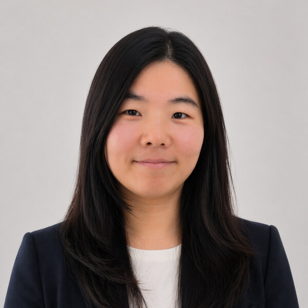

자동차 엔지니어링 현장에서 GitHub Copilot과 AI 에이전트를 도입하며 조직의 AI 혁신을 이끌고 있습니다.

키노트 주제는 곧 공개합니다.

#### 남정현 · 메가존클라우드

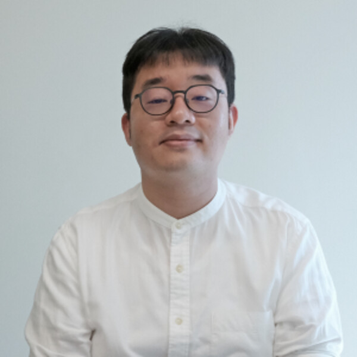

메가존클라우드 Azure Presales 팀에서 Copilot Studio를 중심으로 Microsoft AI 제품의 기술 검증과 현장 적용을 지원합니다.

**AI가 거울에 보이는 것보다 가까이 있음**

AI 시대에 개발자와 소프트웨어의 가치를 돌아보고, 개발자의 역할이 어떻게 달라지는지 이야기합니다.

### 시간표

| 시간 | 내용 |
| --- | --- |
| 09:00 - 18:00 | DDD Seoul 2026 · 세부 시간표 추후 공개 |

### 함께 경험을 나눌 15명의 발표자

| 사진 | 이름 | 소속 |
| --- | --- | --- |
| 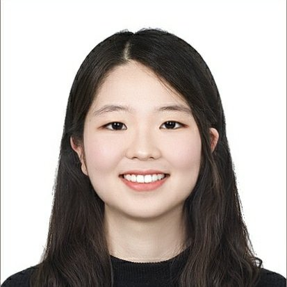 | 권수연 | 바이브컴퍼니 |
| 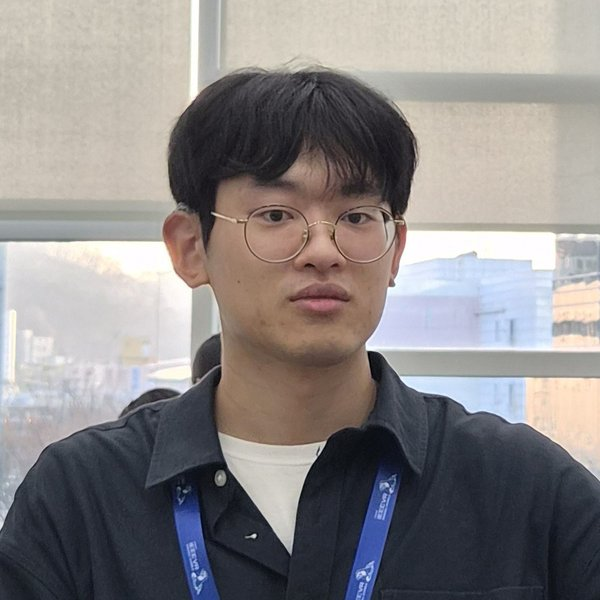 | 김영서 | 니어브레인 |
|  | 김유석 | (주)비락 |
|  | 김인숙 | 가비아 |
| 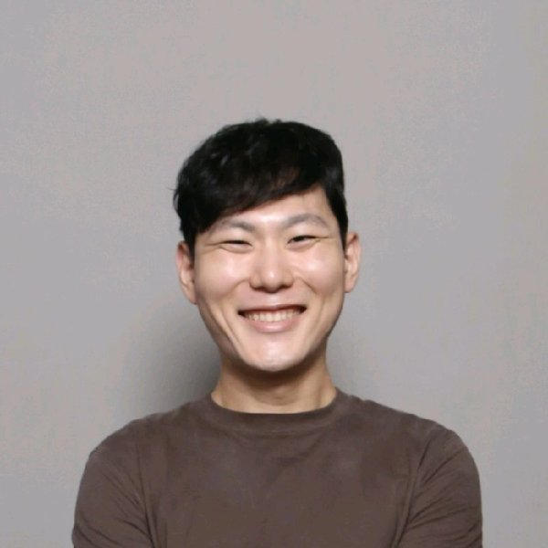 | 김평권 | 프리랜서 |
|  | 문경필 | 한독 |
|  | 박결 | 티오드랩 |
|  | 방소현 | 가비아 |
| 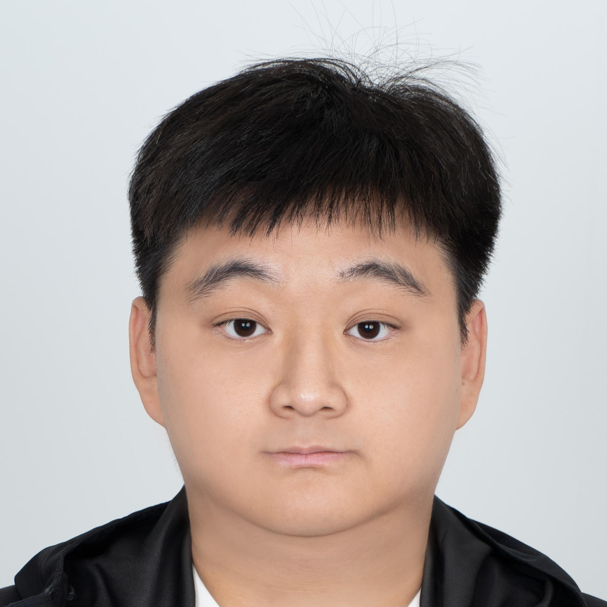 | 손태웅 | 프리랜서 |
|  | 송민석 | Microsoft MVP \| Co-op Translator 메인테이너 |
| 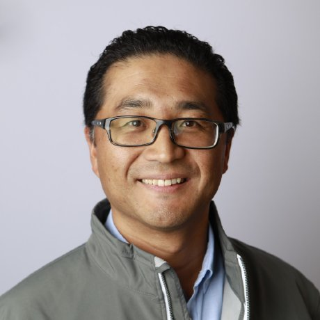 | 유저스틴 | Microsoft |
|  | 전제영 | 현대오토에버 |
| 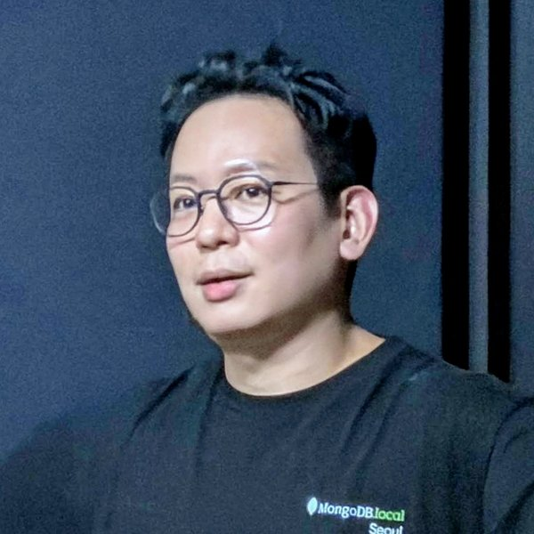 | 정보현 | MongoDB |
|  | 정태영 | 가비아 |
|  | 진미나 | 메가존클라우드 |

## 행사 안내

### 오시는 길

한국 마이크로소프트 13층

서울특별시 종로구 종로1길 50, 더케이트윈타워 A동

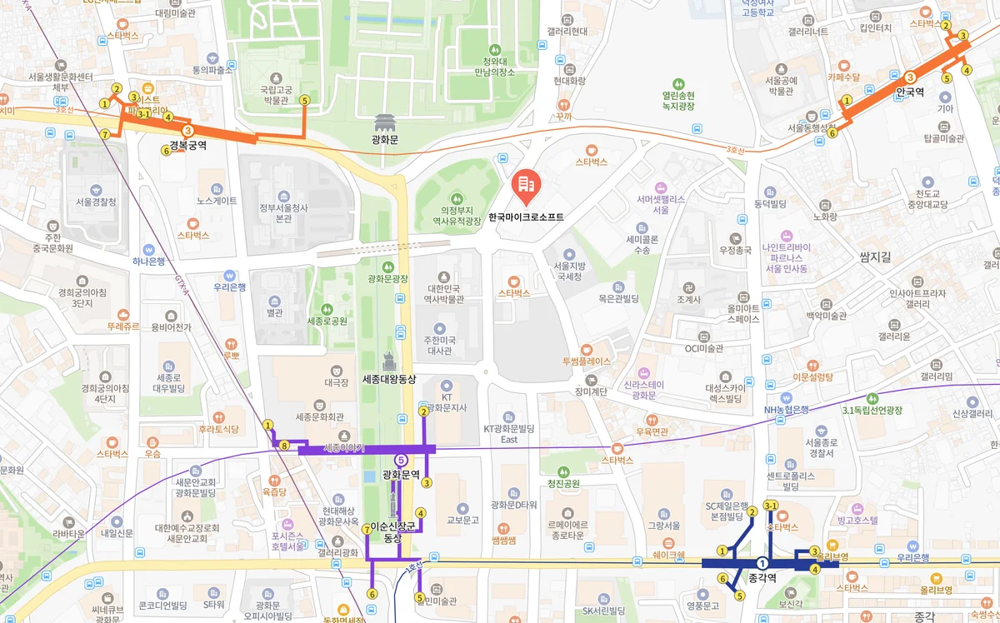

### 입장 및 주차

주차는 지원하지 않습니다. 대중교통을 이용해 주세요.

입장 방법은 추후 안내합니다.

## 후원사

DDD Seoul은 후원사의 도움으로 진행합니다. 함께해 주신 모든 후원사에 감사드립니다.

### 주 후원사

[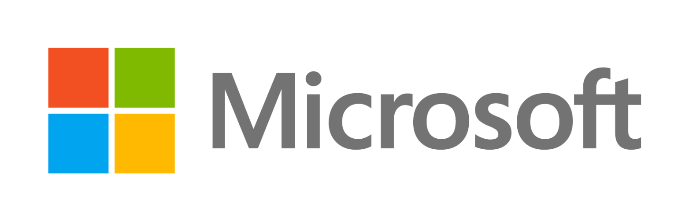](https://www.microsoft.com/ko-kr/)

### 후원사

[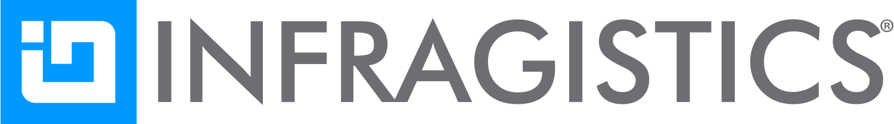](https://www.infragistics.co.kr)

[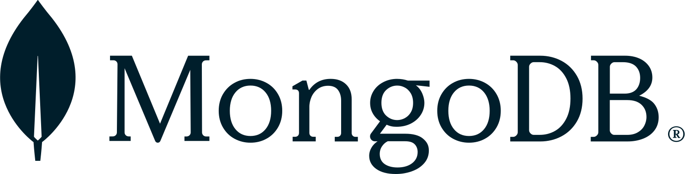](https://www.mongodb.com/ko-kr)

## 커뮤니티 행동 강령

모든 참가자, 발표자, 운영진이 서로 존중하는 행사를 함께 만듭니다.

[DDD Seoul 커뮤니티 행동 강령](https://dddseoul.kr/coc)

## 지난 DDD Seoul

- [DDD Seoul 2024](https://dddseoul.kr/2024)
- [DDD Seoul 2025](https://dddseoul.kr/2025)

<!--
Publishing: index.html uses inline styles and absolute raw.githubusercontent.com
image URLs from this repository's main branch, except for the
official DDD Seoul logo, which keeps its public HTTPS URL. Copy everything inside body,
including the outer div, into Ticketaco. The wrapper carries the background and
layout styles; the head's body margin reset only affects the standalone preview.
The embedded content uses inline styles without CSS classes or scripts.
Ticketaco strips flex item sizing and resets default heading weights. Keep the
explicit width expressions and heading font-weight declarations. Their breakpoints
use the content container's width, not the viewport, so narrow Ticketaco columns
stack naturally. Compare local and embedded content at the same container width.
The main element uses 100% of the available width without its own max-width cap;
Ticketaco's parent container still controls the overall content width and spacing.
Typography uses one 18px base on main; all other font sizes use em. Body copy
inherits 1em, notices use 0.9em, and small labels use 0.8em. Layout containers
inherit the base size. The hero title/year, time/KST and venue/floor use sibling
text spans to avoid multiplying nested font scales.
Push new or updated image assets to main before publishing the HTML to Ticketaco.
images/ also holds a copy of the official logo.
Keep the copy, dates, venue and status in index.html synchronized with this file.
The CFP section and the event-news block with the official homepage link are
intentionally removed from this page.
Registration uses Ticketaco's own button on the right or below the description;
do not add a separate ticket button. Expand #keynote and #schedule independently as
details are confirmed, without replacing the poster hero. Do not invent session times
or speakers. #speakers lists only each speaker's photo, name and affiliation from
https://dddseoul.kr/speakers/{slug}, without links. Its list items use container-based
widths for 5, 3 and 2 columns; keep the 1px slack in each formula.
Image sources:
https://dddseoul.kr/images/logo-dddseoul-whiteorange.png
https://devrel-kr.github.io/event-landing-page/ticketaco/2026/06/lipcoding/images/sponsor-microsoft-cropped.png
https://devrel-kr.github.io/event-landing-page/ticketaco/2026/06/lipcoding/images/sponsor-megazonecloud.png
https://devrel-kr.github.io/event-landing-page/ticketaco/2026/10/ghcp-dev-days-seoul/images/map.webp
https://dddseoul.kr/images/sponsors/infragistics.svg (rendered to sponsor-infragistics.png)
https://dddseoul.kr/images/sponsors/mongodb.svg (rendered to sponsor-mongodb.png)
https://dddseoul.kr/images/speakers/{slug}.jpg (saved as speaker-{slug}.jpg)
speaker-taewoongson-square.jpg is a 1500x1500 top-aligned crop of
speaker-taewoongson.jpg; keep the original. Ticketaco strips object-position,
so the published portrait uses this square asset with height: auto.
https://dddseoul.kr/images/organisers/minajin.png (saved as speaker-minajin.png)
-->
